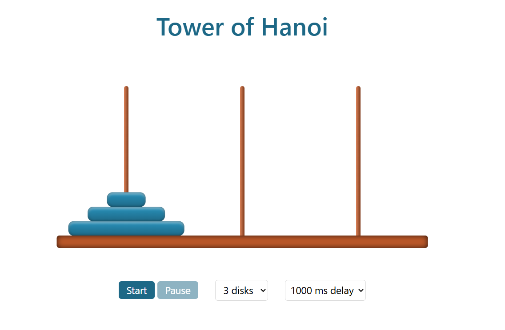

<div align="center">

# Tower of Hanoi

### An Animated Recursive Algorithm Visualizer

**Explore recursion through a step-by-step visualization of the classic Tower of Hanoi puzzle.**

[](https://developer.mozilla.org/en-US/docs/Web/HTML)
[](https://developer.mozilla.org/en-US/docs/Web/CSS)
[](https://developer.mozilla.org/en-US/docs/Web/JavaScript)
[](https://jquery.com/)

</div>

## Preview



## Overview

**Tower of Hanoi** is a browser-based visualization of a classic mathematical puzzle. It uses a recursive algorithm to calculate the moves needed to transfer a stack of disks from one rod to another, then animates those moves in sequence.

The project focuses on **recursion**, **algorithm visualization**, and **asynchronous JavaScript animations**.

## Features

- **Automatic recursive solver** that generates the complete sequence of moves.
- **Animated disk movement** across three rods.
- **Adjustable disk count** from 1 to 10 disks.
- **Start and pause controls** for the visualization.
- **Selectable animation delay** to control playback speed.
- **No build step required** — open the HTML file in a browser.

## Tech Stack

| Technology | Purpose |
| --- | --- |
| HTML5 | Page structure and controls |
| CSS3 | Styling and animated disk movement |
| JavaScript | Recursive solution, state, and animation logic |
| jQuery | DOM updates and event handling |

## How the Algorithm Works

The puzzle starts with all disks on one rod, ordered from largest at the bottom to smallest at the top. The goal is to move the stack to another rod while following three rules:

1. Move only one disk at a time.
2. Move only the top disk from a rod.
3. Never place a larger disk on top of a smaller one.

For `n` disks, the recursive solution:

1. Moves `n - 1` disks from the source to the auxiliary rod.
2. Moves the largest disk from the source to the target rod.
3. Moves `n - 1` disks from the auxiliary rod to the target rod.

The core solver in `hanoi.js` is:

```javascript
function hanoiSequence(numberDisks, origin, helper, target) {
    if (numberDisks == 0) {
        return [];
    }
    else {
        return [
            ...hanoiSequence(numberDisks - 1, origin, target, helper),
            [origin, target],
            ...hanoiSequence(numberDisks - 1, helper, origin, target)
        ];
    }
}
```

The minimum number of moves for `n` disks is **2ⁿ − 1**. For example:

| Disks | Minimum moves |
| ---: | ---: |
| 3 | 7 |
| 4 | 15 |
| 5 | 31 |
| 10 | 1,023 |

**Complexity:** The algorithm generates `2ⁿ − 1` moves, so its time complexity is **O(2ⁿ)**. Because this implementation stores the move sequence in an array, its space complexity is also **O(2ⁿ)**.

## Getting Started

1. Clone the repository:

   ```bash
   git clone https://github.com/AlirezaMP2003/Hanoi.git
   ```

2. Enter the project directory:

   ```bash
   cd Hanoi
   ```

3. Open `index.html` in your browser.

> **Note:** The project loads jQuery from a CDN, so an internet connection is needed to load that dependency unless it is already cached.

## How to Use

1. Choose the number of disks (1–10).
2. Select an animation delay.
3. Click **Start** to watch the solver move the disks.
4. Click **Pause** to stop after the current animated move. Click **Start** again to continue.

## Project Structure

```text
Hanoi/
├── assets/
│   └── hanoi-preview.png   # Screenshot used in README
├── index.html              # Web page and controls
├── hanoi.css               # Layout, disks, and animations
├── hanoi.js                # Recursive solver and playback logic
└── README.md               # Project documentation
```

## What I Practiced

- Recursive problem-solving and breaking a task into smaller subproblems
- Representing algorithm steps as a sequence of moves
- Updating the DOM to visualize program state
- Using `async` / `await` and Promises to animate a sequence
- Styling visual elements with CSS transforms and transitions

## Author

**Alireza Mousapour** · [GitHub @AlirezaMP2003](https://github.com/AlirezaMP2003)
